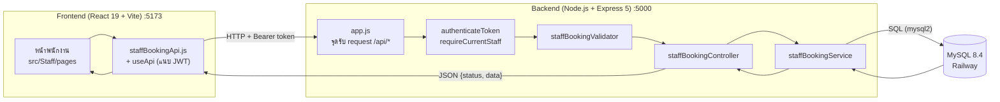
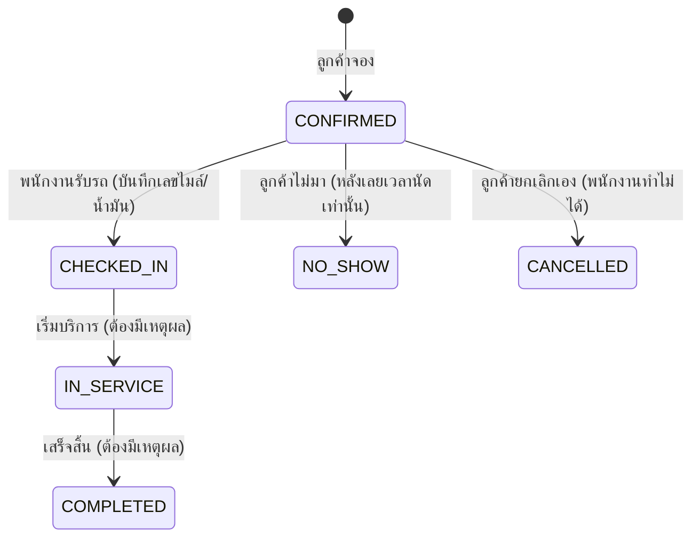
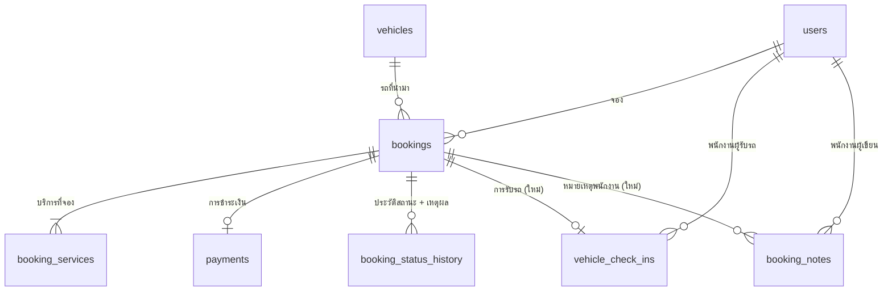

# Car Care Web Service 

**สมาชิก**
- 67150490 เชษฐกิตติ์ สืบสุขสันติ ( Leader Dev & Project Manage )  
- 67115191 ณัฐนันท์  แสงทอง  (  Sorftware Developer & Qa Tester )
- 67159844 ภูริภัทร ทองมวน ( Software developer & Ui Designer )
- -67112963 เมธัส เชยชม  ( Software developer & Ui Designer )

---

# ความคืบหน้า: Staff & Service Management (Flame)

ส่วนงานฝั่งพนักงาน: จัดการคิวงานในร้านและติดตามสถานะรถแต่ละคัน
**ข้อกำหนดสำคัญ:** พนักงานไม่มีสิทธิ์ยกเลิกการจองแทนลูกค้า

| ขอบเขตงาน | สถานะ | อยู่ที่ไหน |
|---|---|---|
| 1. ดูรายการจองในแต่ละวัน | ✅ เสร็จ | หน้า `/staff` + `GET /api/staff/bookings?date=` |
| 2. ดูรายละเอียดลูกค้าและรถยนต์ | ✅ เสร็จ | หน้า `/staff/bookings/:id` + `GET /api/staff/bookings/:id` |
| 3. ตรวจสอบรายการบริการที่ลูกค้าจอง | ✅ เสร็จ | หน้ารายละเอียด (ชื่อบริการ เวลา ราคา ส่วนลด) |
| 4. บันทึกการรับรถเข้าร้าน | ✅ เสร็จ | `POST /api/staff/bookings/:id/check-in` → ตาราง `vehicle_check_ins` |
| 5. เปลี่ยนสถานะการให้บริการ | ✅ เสร็จ | `PATCH /api/staff/bookings/:id/status` |
| 6. บันทึกหมายเหตุและเหตุผล | ✅ เสร็จ | เหตุผล → `booking_status_history.reason`, หมายเหตุ → `booking_notes` |
| 7. บันทึก No-show | ✅ เสร็จ | `POST /api/staff/bookings/:id/no-show` |
| 8. ดูประวัติการให้บริการ | ✅ เสร็จ | หน้า `/staff/history` + ประวัติของรถแต่ละคันในหน้ารายละเอียด |

---

## 1. Architecture: หน้าที่ของแต่ละส่วนและเส้นทางข้อมูล



| ส่วน | ไฟล์ | หน้าที่ |
|---|---|---|
| หน้าเว็บ | `frontend/src/Staff/pages/*.jsx` | แสดงคิวงาน ปฏิทิน รายละเอียด ประวัติ และฟอร์มรับรถ/เปลี่ยนสถานะ |
| ตัวเรียก API | `frontend/src/Staff/api/staffBookingApi.js` | เรียก `/api/staff/bookings` ผ่าน `useApi` ของทีม ซึ่งแนบ `Authorization: Bearer <token>` ให้อัตโนมัติ |
| จุดรับ request | `backend/app.js` | ผูก path `/api/staff/bookings` กับ router ของพนักงาน |
| Route | `backend/Staff/routes/staffBookingRoutes.js` | กำหนด endpoint และลำดับ middleware |
| Middleware | `backend/Auth/middleware/authMiddleware.js` | ตรวจ JWT และตรวจว่า role ปัจจุบันใน DB เป็น STAFF |
| Validator | `backend/Staff/validators/staffBookingValidator.js` | ตรวจข้อมูลที่ส่งมา ถ้าผิดตอบ 400 ก่อนถึง DB |
| Controller | `backend/Staff/controllers/staffBookingController.js` | แปลงผลลัพธ์/error เป็น HTTP status (200/400/403/404/409/500) |
| Service | `backend/Staff/services/staffBookingService.js` | คำสั่ง SQL และกติกาการเปลี่ยนสถานะ ใช้ transaction + `SELECT ... FOR UPDATE` กันพนักงาน 2 คนแก้การจองเดียวกันพร้อมกัน |
| ฐานข้อมูล | MySQL บน Railway | เก็บข้อมูลจริง |

> **หมายเหตุเรื่อง API Gateway:** โปรเจกต์นี้ยังไม่มี API Gateway แยกเป็นบริการ ตอนนี้ `backend/app.js` ทำหน้าที่เป็นจุดรับ request เดียวของทุก `/api/*` แล้วส่งต่อไปยัง router ของแต่ละโมดูล (Auth, Customer, Admin, Staff)

### กติกาสถานะที่พนักงานทำได้



---

## 2. API implementation: Endpoint และ HTTP Methods

ทุก endpoint ต้องส่ง header `Authorization: Bearer <JWT>` ของผู้ใช้ role `STAFF`

| Method | Endpoint | ใช้ทำอะไร | Body / Query |
|---|---|---|---|
| `GET` | `/api/staff/bookings` | 1) คิวรายวัน · 8) ประวัติ | `date` หรือ `date_from` + `date_to`, `booking_status`, `search`, `vehicle_id`, `page`, `limit` (≤ 200) |
| `GET` | `/api/staff/bookings/:id` | 2) 3) รายละเอียดลูกค้า รถ บริการ + ไทม์ไลน์ | – |
| `POST` | `/api/staff/bookings/:id/check-in` | 4) รับรถเข้าร้าน | `{ mileage, fuel_level, condition_note?, note? }` |
| `PATCH` | `/api/staff/bookings/:id/status` | 5) 6) เปลี่ยนสถานะ + เหตุผล | `{ status, reason }` |
| `POST` | `/api/staff/bookings/:id/no-show` | 7) ลูกค้าไม่มาตามนัด | `{ reason }` |
| `POST` | `/api/staff/bookings/:id/notes` | 6) หมายเหตุ (ไม่เปลี่ยนสถานะ) | `{ note }` |

**ทำไมไม่มี `PUT` และ `DELETE`:**
- ไม่มี `DELETE` โดยตั้งใจ เพราะพนักงานต้องลบหรือยกเลิกการจองไม่ได้ ถ้าส่ง `status: "CANCELLED"` มาที่ `PATCH /status` ระบบจะตอบ `403`
- ใช้ `PATCH` แทน `PUT` เพราะแก้แค่ฟิลด์สถานะ ไม่ได้แทนที่ข้อมูลการจองทั้งก้อน

ตัวอย่าง request และ response:

```http
PATCH /api/staff/bookings/5/status
Authorization: Bearer eyJhbGciOi...
Content-Type: application/json

{ "status": "IN_SERVICE", "reason": "ช่างเริ่มงานแล้ว" }
```

```json
{
  "status": "success",
  "data": {
    "booking": { "booking_id": 5, "booking_status": "IN_SERVICE", "...": "..." },
    "customer": { "full_name": "...", "phone": "..." },
    "vehicle": { "license_plate": "...", "brand_name": "Mercedes-Benz", "model_name": "C-Class" },
    "services": [{ "service_name": "Basic Wash", "unit_price": "150.00" }],
    "status_history": [{ "old_status": "CHECKED_IN", "new_status": "IN_SERVICE", "reason": "ช่างเริ่มงานแล้ว" }],
    "allowed_next_statuses": ["COMPLETED"]
  }
}
```

เอกสาร API ฉบับเต็มอยู่ที่ [`backend/API_DOCUMENTATION.md`](backend/API_DOCUMENTATION.md) หัวข้อ "Staff APIs"

---

## 3. Database: โครงสร้างข้อมูลและผลการบันทึกข้อมูลจริง

ฐานข้อมูล MySQL 8.4 อยู่บน Railway (database `railway`)

### ตารางที่ส่วนพนักงานใช้



ตารางเดิมของทีมที่อ่าน/เขียน: `bookings`, `users`, `vehicles`, `vehicle_models`, `vehicle_brands`, `vehicle_types`, `booking_services`, `payments`, `booking_status_history`

**ตารางใหม่ 2 ตาราง** สร้างจาก [`database/migrations/2026-11-15_staff_service.sql`](database/migrations/2026-11-15_staff_service.sql)

| ตาราง | คอลัมน์หลัก | หมายเหตุ |
|---|---|---|
| `vehicle_check_ins` | `booking_id` (UNIQUE, FK), `mileage`, `fuel_level` (`EMPTY`/`QUARTER`/`HALF`/`THREE_QUARTER`/`FULL`), `condition_note`, `checked_in_by` (FK users), `checked_in_at` | 1 การจองรับรถได้ครั้งเดียว |
| `booking_notes` | `booking_id` (FK), `note`, `created_by` (FK users), `created_at` | หมายเหตุที่ไม่เปลี่ยนสถานะ |

### หลักฐานจากฐานข้อมูลจริง (ตรวจเมื่อ 15 พ.ย. 2569)
- เชื่อมต่อ Railway ได้ ดูได้จาก `GET /api/health/db` ซึ่งตอบ `{"status":"success","database":"railway"}`
- รัน migration บน Railway แล้ว มีตาราง `vehicle_check_ins` และ `booking_notes` จริง
- ข้อมูลในระบบตอนตรวจ: การจอง 7 รายการ (CONFIRMED 6, CANCELLED 1) และผู้ใช้ ADMIN 1, CUSTOMER 3, STAFF 1
- `GET /api/staff/bookings` ดึงการจองจริงได้ครบ 7 รายการ พร้อมชื่อบริการและทะเบียนรถ
- `GET /api/staff/bookings/:id` ของการจอง #1, #2, #5 คืนข้อมูลลูกค้า รถ บริการ ราคา และการชำระเงินถูกต้อง

SQL สำหรับเปิดให้ดูตอนนำเสนอ (หลังกดรับรถหรือเปลี่ยนสถานะในหน้าเว็บ):

```sql
-- การรับรถล่าสุด
SELECT c.booking_id, c.mileage, c.fuel_level, c.condition_note, u.full_name AS staff, c.checked_in_at
FROM vehicle_check_ins c JOIN users u ON u.user_id = c.checked_in_by
ORDER BY c.checked_in_at DESC LIMIT 5;

-- ประวัติสถานะพร้อมเหตุผล
SELECT h.booking_id, h.old_status, h.new_status, h.reason, u.full_name AS changed_by, h.created_at
FROM booking_status_history h LEFT JOIN users u ON u.user_id = h.changed_by
ORDER BY h.created_at DESC LIMIT 10;

-- หมายเหตุของพนักงาน
SELECT n.booking_id, n.note, u.full_name AS staff, n.created_at
FROM booking_notes n JOIN users u ON u.user_id = n.created_by
ORDER BY n.created_at DESC LIMIT 10;
```

---

## 4. Integration: Frontend → Backend → Database

ลำดับการทำงานจริงตอนพนักงานกด "รับรถเข้าร้าน":

1. **หน้าเว็บ:** `StaffBookingDetailPage.jsx` เปิดฟอร์มรับรถ ตรวจว่าเลขไมล์เป็นจำนวนเต็ม แล้วเรียก `checkInBooking(api, id, body)`
2. **ตัวเรียก API:** `staffBookingApi.js` ส่ง `POST http://localhost:5000/api/staff/bookings/:id/check-in` โดย `useApi` แนบ JWT จาก sessionStorage
3. **Backend:** `app.js` → `authenticateToken` (ตรวจลายเซ็นและวันหมดอายุของ JWT) → `requireCurrentStaff` (ตรวจ role ใน DB) → `validateCheckIn` → controller → service
4. **Service:** เปิด transaction, `SELECT ... FOR UPDATE` ล็อกแถวการจอง, ตรวจว่าเป็น `CONFIRMED`, `INSERT vehicle_check_ins`, `UPDATE bookings` เป็น `CHECKED_IN`, `INSERT booking_status_history` แล้ว commit
5. **ตอบกลับ:** ส่งรายละเอียดการจองที่อัปเดตแล้วกลับไป หน้าเว็บแสดงสถานะใหม่และไทม์ไลน์ทันทีโดยไม่ต้องโหลดหน้าใหม่

ปฏิทินในหน้าคิวงานเรียก `GET /api/staff/bookings?date_from=&date_to=` เดือนละครั้ง แล้วนับจำนวนการจองต่อวันเพื่อแสดงจุดสีและตัวเลข

**วิธีรันเพื่อสาธิต**

```bash
cd backend && npm install && npm start      # http://localhost:5000
cd frontend && npm install && npm run dev   # http://localhost:5173
```

จากนั้นล็อกอินด้วยบัญชี role `STAFF` ระบบจะพาไปหน้า `/staff` เอง

ถ้าอยากดูหน้าจอโดยไม่ต่อ backend ให้สร้างไฟล์ `frontend/.env.local` ที่มีบรรทัด `VITE_STAFF_MOCK=true` หน้าพนักงานจะใช้ข้อมูลจำลองจาก `staffMockApi.js` แทน

---

## 5. Security: การตรวจสอบ JWT และการจัดการสิทธิ์

| ชั้น | ตรวจอะไร | ถ้าไม่ผ่าน |
|---|---|---|
| `authenticateToken` | ต้องมี header `Authorization: Bearer <token>` และ token ต้องเซ็นด้วย `JWT_SECRET` และยังไม่หมดอายุ (`JWT_EXPIRES_IN`) | `401 Authentication required.` / `401 Invalid or expired token.` |
| `requireCurrentStaff` | อ่าน `role` และ `status` **ล่าสุดจากตาราง users** ไม่เชื่อแค่ใน token ถ้า Admin เปลี่ยน role หรือปิดบัญชี สิทธิ์จะหายทันที | `401` ถ้าบัญชีถูกปิดหรือ role ไม่ตรงกับ token, `403 Staff access required.` ถ้าไม่ใช่ STAFF |
| Validator | รับเฉพาะฟิลด์ที่กำหนด เช่น check-in รับแค่ `mileage`, `fuel_level`, `condition_note`, `note` ตรวจชนิด ความยาว และค่าที่อนุญาต | `400` |
| Service | ห้ามยกเลิกการจองแทนลูกค้า และเปลี่ยนสถานะได้ตามลำดับที่กำหนดเท่านั้น | `403` / `409` |
| SQL | ใช้ parameterized query (`?`) ทุกคำสั่ง ป้องกัน SQL injection | – |

ฝั่งหน้าเว็บ: `App.jsx` พาผู้ใช้ role `STAFF` ไปที่ `/staff/*` เท่านั้น แต่การป้องกันจริงอยู่ที่ backend ถ้าลูกค้ายิง API พนักงานเองจะได้ `403`

**ข้อกำหนดของ `.env`:** `JWT_SECRET` ต้องยาวอย่างน้อย 32 ตัวอักษร และต้องตั้ง `JWT_EXPIRES_IN` เช่น `8h` ถ้าไม่ครบ การล็อกอินจะตอบ `500` (ดู `backend/.env.example`)

---

## 6. Testing: ผลทดสอบ API และกรณี Error

รันเทสต์:

```bash
cd backend && node --test test/*.test.js
```

**ผลล่าสุด (15 พ.ย. 2569):** `tests 139 · pass 139 · fail 0` (ทั้งโปรเจกต์) และฝั่ง frontend `npx eslint .` ไม่มี error, `npm run build` สำเร็จ

เทสต์เฉพาะส่วนพนักงาน อยู่ใน [`backend/test/staffBookingRoutes.test.js`](backend/test/staffBookingRoutes.test.js) (7 เทสต์ ผ่านทั้งหมด):

| # | เทสต์ | ผลที่คาดหวัง |
|---|---|---|
| 1 | customers cannot use staff booking APIs | ลูกค้าเรียก API พนักงาน → `403` |
| 2 | staff cannot cancel bookings | ส่ง `status: "CANCELLED"` → `403` |
| 3 | status change requires a reason | เปลี่ยนสถานะโดยไม่มี `reason` → `400` |
| 4 | check-in validates mileage and fuel level | เลขไมล์ติดลบ / `fuel_level` ผิด → `400` |
| 5 | status change rejects transitions outside the allowed flow | เช่น `CONFIRMED` → `COMPLETED` ข้ามขั้น → `409` |
| 6 | no-show is rejected before the appointment time | บันทึก No-show ก่อนถึงเวลานัด → `409` |
| 7 | daily list filters by date and returns service names | `?date=` คืนเฉพาะวันนั้น พร้อม `service_names` → `200` |

### ตัวอย่าง Error ที่ระบบตอบกลับ

| สถานการณ์ | HTTP | Response |
|---|---|---|
| ไม่ส่ง token | 401 | `{"status":"error","message":"Authentication required."}` |
| token ผิดหรือหมดอายุ | 401 | `{"status":"error","message":"Invalid or expired token."}` |
| ลูกค้าเรียก API พนักงาน | 403 | `{"status":"error","message":"Staff access required."}` |
| พนักงานพยายามยกเลิกการจอง | 403 | `{"status":"error","message":"Staff cannot cancel bookings on behalf of customers."}` |
| เลขไมล์ไม่ถูกต้อง | 400 | `{"status":"error","message":"mileage must be an integer between 0 and 9999999."}` |
| ช่วงวันที่กลับด้าน | 400 | `{"status":"error","message":"date_from must not be after date_to."}` |
| ไม่พบการจอง | 404 | `{"status":"error","message":"Booking not found."}` |
| รับรถซ้ำ | 409 | `{"status":"error","message":"Only CONFIRMED bookings can be checked in."}` |
| No-show ก่อนเวลานัด | 409 | `{"status":"error","message":"Cannot mark no-show before the appointment time."}` |
| หมายเหตุในการจองที่ยกเลิกแล้ว | 409 | `{"status":"error","message":"Cannot add notes to a cancelled booking."}` |

---

## 7. Project status

### ✅ เสร็จแล้ว
- Backend โมดูล Staff ครบ 6 endpoint พร้อม validator, การตรวจสิทธิ์ และ transaction
- ตารางใหม่ `vehicle_check_ins`, `booking_notes` สร้างบน Railway แล้ว
- หน้าเว็บพนักงาน 3 หน้า (คิวงาน, รายละเอียด, ประวัติ) ใช้ธีมเดียวกับหน้าหลัก กว้างเต็มจอ มีปฏิทินแสดงจุดวันที่มีการจอง
- โหมดข้อมูลจำลอง (`VITE_STAFF_MOCK`) สำหรับพัฒนาหน้าเว็บโดยไม่ต้องมี backend
- เทสต์ backend ผ่าน 139/139 และอัปเดต `API_DOCUMENTATION.md`

### 🔄 กำลังดำเนินการ
- Pull Request จาก branch `feat/staff-service` เข้า `main` รอเพื่อนในทีมตรวจ
- ทดสอบครบทุกขั้นกับข้อมูลจริง (ล็อกอิน STAFF → รับรถ → เปลี่ยนสถานะ → ปิดงาน) บน Railway

### ⚠️ ปัญหาที่พบ
- `database/schema.sql` ของทีมยังว่าง สมาชิกใหม่จึงตั้ง Database ในเครื่องเองไม่ได้ ต้องใช้ Railway อย่างเดียว
- `.env` ต้องมี `JWT_SECRET` ยาว ≥ 32 ตัวอักษร และ `JWT_EXPIRES_IN` ไม่งั้นล็อกอินไม่ได้ (เพิ่มไว้ใน `.env.example` แล้ว)
- โค้ด Staff เวอร์ชันแรกของเพื่อน (`StaffDashboard`, `Staff/*/booking*.js`) ถูกแทนด้วยเวอร์ชันนี้ API `PATCH /status` เปลี่ยนให้ต้องส่ง `reason` ทุกครั้ง และย้ายการรับรถไปใช้ `POST /check-in` ต้องแจ้งทีม
- ไฟล์ migration ต้องรันเองทีละครั้ง ยังไม่มีระบบ migration อัตโนมัติ

### 📌 แผนงานถัดไป
1. Merge เข้า `main` หลังเพื่อนตรวจ และแจ้งการเปลี่ยน API ให้ทีม
2. เพิ่มข้อมูลทดสอบ (seed) ของการรับรถและหมายเหตุ เพื่อใช้สาธิต
3. เพิ่มเทสต์ของ check-in สำเร็จ, หมายเหตุ และประวัติรถรายคัน
4. ขอให้ทีม export โครงสร้างฐานข้อมูลลง `database/schema.sql`
