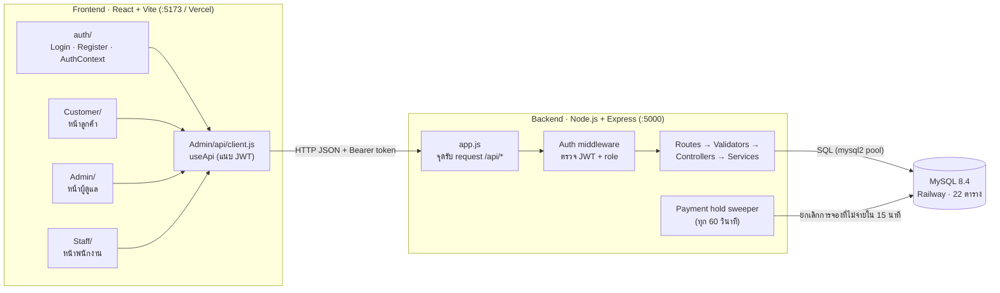
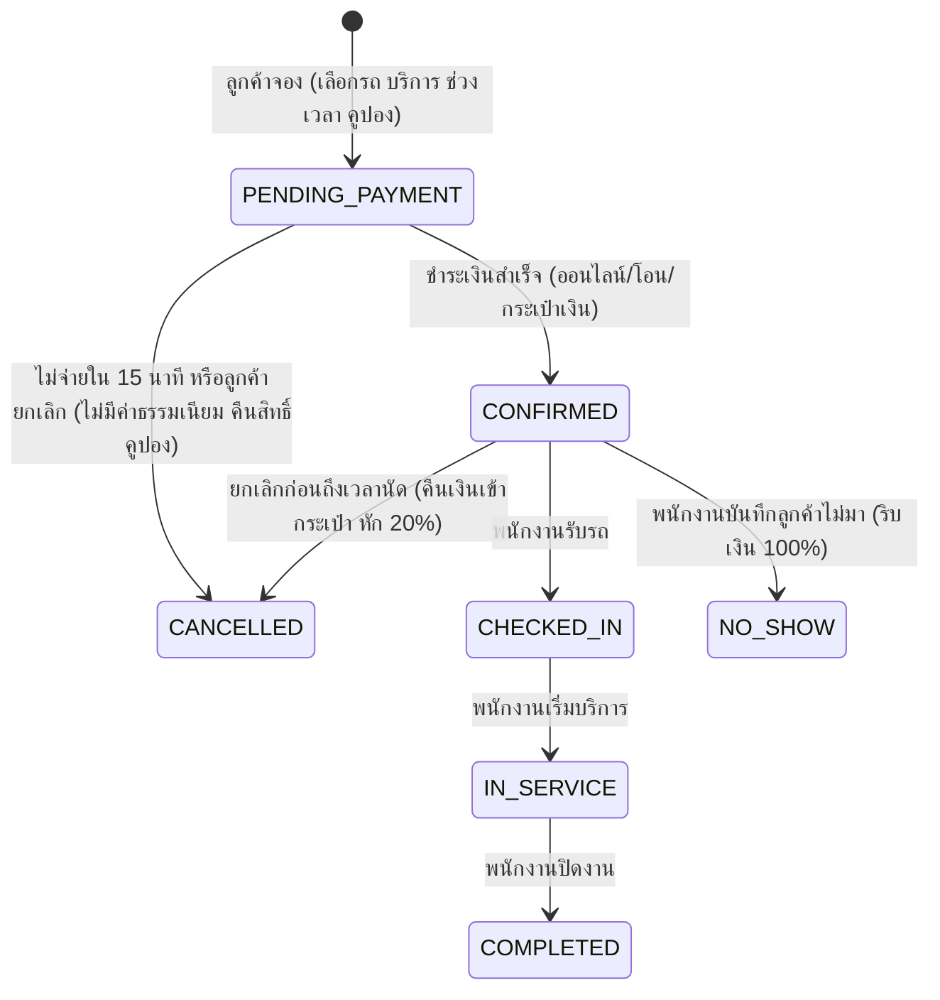
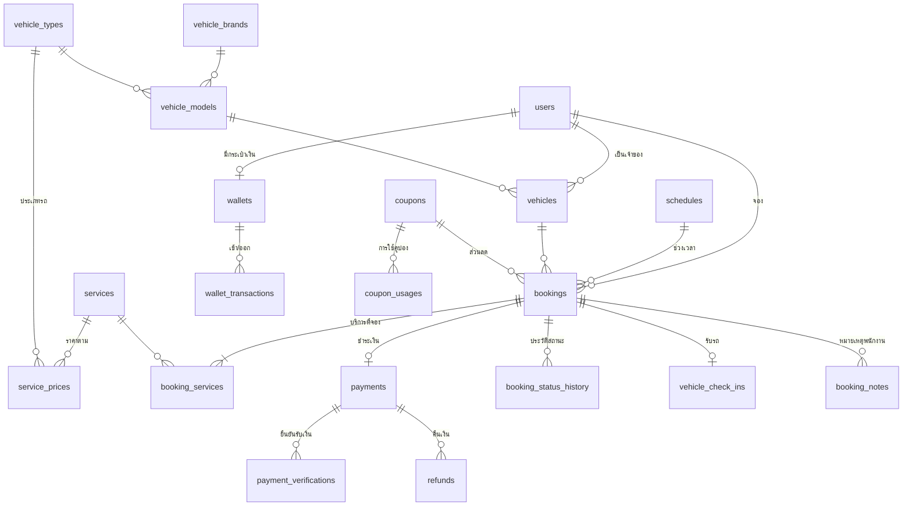

# Car Care Web Service 

**สมาชิก**
- 67150490 เชษฐกิตติ์ สืบสุขสันติ ( Leader Dev & Project Manage )  
- 67115191 ณัฐนันท์  แสงทอง  (  Sorftware Developer & Qa Tester )
- 67159844 ภูริภัทร ทองมวน ( Software developer & Ui Designer )
- -67112963 เมธัส เชยชม  ( Software developer & Ui Designer )

---

# การนำเสนอความคืบหน้า (CSI400)

ระบบจองบริการดูแลรถยนต์ออนไลน์ ใช้งานได้ 3 บทบาท
- **ลูกค้า (CUSTOMER):** จองบริการ ใช้คูปอง ชำระเงิน ยกเลิก และดูประวัติ
- **ผู้ดูแลระบบ (ADMIN):** จัดการข้อมูลหลัก ผู้ใช้ คูปอง ตารางเวลา การจอง และรายงาน
- **พนักงาน (STAFF):** จัดการคิวงานในร้าน ยืนยันการรับเงิน และติดตามสถานะรถแต่ละคัน

| ส่วน | เทคโนโลยี |
|---|---|
| Frontend | React 19, Vite 8, lucide-react, three.js + React Three Fiber/drei (เฉพาะรถ 3D หน้า Login) (deploy บน Vercel) |
| Backend | Node.js, Express 5, mysql2, jsonwebtoken, bcryptjs, cors, dotenv |
| Database | MySQL 8.4 บน Railway |
| Testing | `node:test` (เทสต์ในตัวของ Node.js), ESLint |

ข้อมูลทุกตัวเลขในเอกสารนี้ตรวจจากโค้ดและฐานข้อมูลจริง ณ วันที่ 20 พ.ย. 2569

---

## 1. Architecture: หน้าที่ของแต่ละบริการและเส้นทางข้อมูล



### Frontend (`frontend/src`)
| โฟลเดอร์ | หน้าที่ |
|---|---|
| `App.jsx` | ตัวเลือกหน้าตาม URL และพาผู้ใช้ไปพื้นที่ของ role ตัวเอง (`/customer`, `/admin`, `/staff`) |
| `auth/` | หน้า Login และ Register แบบ "โรงรถ" (รถ Urus 3D + เสียงเครื่องยนต์ ดูหัวข้อถัดไป), `AuthContext` เก็บ JWT ใน sessionStorage และตรวจ session ด้วย `GET /api/auth/me` |
| `Customer/` | หน้าแรก (ดูราคาตามประเภทรถ, ขั้นตอนใช้บริการ, นโยบายยกเลิก, พื้นหลังแอนิเมชัน), บริการ, เกี่ยวกับโปรเจกต์ `/about` (ทีมผู้พัฒนา, อาจารย์ผู้สอน, License, เครดิต), แดชบอร์ด, โปรไฟล์, รถของฉัน, จองบริการ (เลือกคูปอง), การจองของฉัน, ชำระเงิน, กระเป๋าเงิน |
| `Admin/` | แดชบอร์ด, การจอง, ลูกค้า, พนักงาน, บริการและราคา, ประเภทรถ, ตารางเวลา, คูปอง, การชำระเงิน, กระเป๋าเงิน, รายงาน |
| `Staff/` | คิวงานรายวันพร้อมปฏิทิน, รายละเอียดการจอง (รับรถ/เปลี่ยนสถานะ/หมายเหตุ/No-show/ยืนยันรับเงิน), ประวัติการให้บริการ |
| `i18n/` | สลับภาษาไทย/อังกฤษ (`messages.js`) |
| `Admin/api/client.js` | ตัวเรียก API กลาง ใช้ร่วมกันทุกส่วน ใส่ `Authorization: Bearer <token>` และอ่าน `VITE_API_BASE_URL` |

### หน้า Login / Register: โรงรถ Urus
`/login` และ `/register` ใช้หน้าเดียวกัน (`AuthGaragePage`) สลับไปมาแล้วเครื่องยนต์ยังติดอยู่

| จังหวะ | สิ่งที่เกิดขึ้น |
|---|---|
| เปิดหน้า | โรงรถมืด เห็นรถจางๆ แตะที่รถเพื่อสตาร์ท (หรือกด "ข้าม" / รอ 2 วินาทีจะสตาร์ทเองแบบเงียบ) เปิดซ้ำในแท็บเดิมจะเห็นฟอร์มทันที |
| สตาร์ท | รถสั่น ไฟท้ายติด ควันออกท่อ ไฟหน้ากะพริบแล้วส่องไปที่ฟอร์ม ฟอร์มค่อยๆ ปรากฏในลำแสง จากนั้นเครื่องเดินเบา |
| แตะรถ | เร่งเครื่อง หน้ารถเชิด ควันพุ่ง |
| สลับ Login ↔ Register | คันเกียร์เลื่อน รถกระตุกเหมือนเปลี่ยนเกียร์ |
| กรอกผิด / รหัสผิด | เครื่องสะดุด รถสั่นแรง |
| ล็อกอินสำเร็จ | รถวิ่งออกจากจอ แล้วจึงบันทึก session และพาไปหน้าตาม role (`login()` รับ `beforeCommit` เพื่อรอแอนิเมชัน) |

| ไฟล์ (`frontend/src/auth/`) | หน้าที่ |
|---|---|
| `AuthGaragePage.jsx` | สถานะรถ (ดับ → สตาร์ท → เดินเครื่อง → วิ่งออก), ปุ่มข้าม, ปุ่มเสียง, คันเกียร์, ท่ารถสั่น |
| `LoginForm.jsx`, `RegisterForm.jsx`, `PasswordField.jsx` | ฟอร์มเดิม (logic เดิม) + ปุ่มแสดง/ซ่อนรหัสผ่าน |
| `CarModel.jsx`, `useCarModel3d.js` | เลือกรถ 3D หรือรถ SVG (ใช้ 3D เมื่อมีไฟล์โมเดลและเครื่องรองรับ WebGL) |
| `UrusScene3D.jsx` | ฉาก 3D: ปรับขนาด/ทิศรถ, ทาสีเหลือง, ซ่อนโลโก้, กระจกดำ, ไฟหน้า/ไฟท้าย, แสงสตูดิโอ, เงา ค่าที่ปรับได้อยู่บนสุดของไฟล์ |
| `SuperSuv.jsx` | รถ SVG สำรอง และแสดงระหว่างรอโมเดลโหลด |
| `engineSound.js` | ตัดเสียงจริงเป็นช่วง (สตาร์ท, เร่ง, เปลี่ยนเกียร์, สะดุด, วิ่งออก), เสียงเดินเบาวน, จำค่าปิดเสียง, หยุดเมื่อสลับแท็บ, มีเสียงสังเคราะห์สำรอง |

- **โหลดเฉพาะที่ใช้:** โค้ด three.js (~285 KB gzip) แยกเป็นไฟล์ของตัวเอง โหลดเฉพาะหน้า Login/Register ที่มีโมเดล หน้าอื่นไม่โหลด
- **ทางสำรอง:** ถ้าไม่มี `public/models/urus.glb`, เครื่องไม่รองรับ WebGL หรือฉาก 3D error จะแสดงรถ SVG แทน หน้าไม่พัง ถ้าตั้งค่าลดการเคลื่อนไหวในเครื่อง จะข้ามแอนิเมชันและแสดงฟอร์มทันที
- **เสียง:** ดังเฉพาะหลังผู้ใช้กดหรือพิมพ์ (ข้อกำหนดของเบราว์เซอร์) ปิดได้ทั้งหมดด้วยปุ่มลำโพง หรือปิดเฉพาะเสียงเดินเบา
- **หลัง `git pull` ต้องรัน `npm install` ใน `frontend`** เพราะมีแพ็กเกจ `three`, `@react-three/fiber`, `@react-three/drei`

| ไฟล์ประกอบ (`frontend/public/`) | ที่มาและสัญญาอนุญาต |
|---|---|
| `models/urus.glb` (1.8 MB) | "2019 Lamborghini Urus" โดย Ddiaz Design (Sketchfab), **CC BY-NC-SA 4.0** ใช้ได้เฉพาะงานไม่แสวงกำไร ไฟล์นี้ตัดห้องโดยสาร/เครื่องยนต์/โลโก้ออกและบีบอัดจาก 17 MB ด้วย gltf-transform (meshopt) |
| `sounds/urus.mp3` (224 KB) | "Lamborghini Urus racing sound effect" โดย mizanstock (Pixabay), Pixabay Content License |

ทั้งสองไฟล์มีเครดิตในหน้า `/about` แล้ว

### Backend (`backend/`)
ทุกโมดูลแบ่งชั้นเหมือนกัน: **routes** (กำหนด path + middleware) → **validators** (ตรวจข้อมูลเข้า) → **controllers** (แปลงผลเป็น HTTP status) → **services** (SQL และกติกาธุรกิจ)

| โมดูล | หน้าที่ |
|---|---|
| `Auth/` | ล็อกอิน, ตรวจ session, ออกจากระบบ, สมัครสมาชิกลูกค้า และ middleware ตรวจ JWT/role |
| `Public/` | แคตตาล็อกบริการพร้อมราคาตามประเภทรถ ไม่ต้องล็อกอิน (หน้าแรก) |
| `Customer/` | โปรไฟล์, รถของลูกค้า, แคตตาล็อกรถ/บริการ/ราคา, ตารางเวลาว่าง, คูปอง, สร้างการจอง, ประวัติ |
| `Admin/` | ข้อมูลหลัก (ประเภท/ยี่ห้อ/รุ่นรถ, บริการ, ราคา), ผู้ใช้และสิทธิ์, ตารางเวลา, คูปอง, การจอง, รายงาน, แดชบอร์ด และบริการกลางเรื่องชำระเงิน/ยกเลิก/กระเป๋าเงิน |
| `Staff/` | คิวงาน, รับรถ, เปลี่ยนสถานะ, No-show, หมายเหตุ |
| `shared/config/db.js` | connection pool ของ MySQL อ่านค่าจาก `backend/.env` |
| `shared/services/` | `bookingPaymentHold` (ล็อกช่วงเวลา 15 นาทีรอจ่าย), `couponPricing` (คำนวณส่วนลด), `shopTime` (เวลาไทย UTC+7 เพราะ Railway ใช้ UTC), `slotPlanner` (จองต่อหลายรอบ), `verifiedPaymentSql` |
| `scripts/generate-schedules.js` | สร้างช่วงเวลาให้บริการล่วงหน้า 30 วัน (จันทร์–เสาร์ วันละ 6 รอบ รอบละ 90 นาที รับได้ 2 คัน) |

> **เรื่อง API Gateway:** ตอนนี้ยังไม่มี API Gateway แยกเป็นบริการ `backend/app.js` ทำหน้าที่เป็นจุดรับ request เดียวของทุก `/api/*` แล้วส่งต่อไปยัง router ของแต่ละโมดูล พร้อมตั้ง CORS และแปลง JSON ให้ทุก request

### เส้นทางข้อมูลหลักของระบบ (วงจรการจอง)



---

## 2. API implementation: Endpoint และ HTTP Methods

ทั้งระบบมี **84 endpoint** นับจาก route ที่เปิดใช้ใน `backend/app.js`

| กลุ่ม | จำนวน | สิทธิ์ที่ต้องมี |
|---|---|---|
| Auth: ล็อกอิน / สมัครสมาชิก | 7 | `login` และ `register` ไม่ต้องล็อกอิน, ที่เหลือต้องมี token |
| Public | 1 | ไม่ต้องล็อกอิน |
| Customer | 17 | CUSTOMER |
| Shared: payments / cancellations / wallet | 9 | CUSTOMER (เฉพาะของตัวเอง) หรือ ADMIN, ยืนยันรับเงินใช้ STAFF/ADMIN |
| Admin | 42 | ADMIN |
| Staff | 6 | STAFF |
| System (`/`, `/api/health/db`) | 2 | ไม่ต้องล็อกอิน |

| HTTP Method | จำนวน | ตัวอย่าง |
|---|---|---|
| `GET` | 44 | `GET /api/customer/bookings`, `GET /api/admin/reports/revenue`, `GET /api/staff/bookings?date=` |
| `POST` | 21 | `POST /api/auth/login`, `POST /api/customer/bookings`, `POST /api/payments/:bookingId` |
| `PATCH` | 17 | `PATCH /api/admin/users/:id/role`, `PATCH /api/customer/profile`, `PATCH /api/staff/bookings/:id/status` |
| `PUT` | 1 | `PUT /api/admin/services/:id/prices` (แทนที่ตารางราคาของบริการทั้งชุด) |
| `DELETE` | 1 | `DELETE /api/customer/vehicles/:vehicleId` |

ระบบเลือกใช้ `PATCH` เป็นหลักแทน `PUT` เพราะส่วนใหญ่แก้แค่บางฟิลด์ ส่วน "ลบ" ข้อมูลหลักใช้การเปลี่ยน `status` เป็น `INACTIVE` (เช่น `PATCH .../:id/status`) เพื่อไม่ให้ข้อมูลเก่าที่อ้างอิงอยู่เสีย

### รายการ API ทั้งหมด (84 ตัว)

**สิทธิ์:** `Public` = ไม่ต้องล็อกอิน · `CUSTOMER` / `ADMIN` / `STAFF` = ต้องล็อกอินด้วย role นั้น · `CUSTOMER/ADMIN` = ลูกค้า (เฉพาะข้อมูลของตัวเอง) หรือ Admin

#### Auth: ล็อกอินและสมัครสมาชิก (7)
| # | Method | Endpoint | ใช้ทำอะไร | สิทธิ์ |
|---|---|---|---|---|
| 1 | `POST` | `/api/auth/login` | ล็อกอินด้วยอีเมลและรหัสผ่าน ได้ JWT กลับมา (ทุก role) | Public |
| 2 | `GET` | `/api/auth/me` | ดูข้อมูลผู้ใช้ที่ล็อกอินอยู่ (ใช้ตรวจ session ตอนเปิดเว็บ) | ADMIN / STAFF / CUSTOMER |
| 3 | `POST` | `/api/auth/logout` | ออกจากระบบ | ADMIN / STAFF / CUSTOMER |
| 4 | `POST` | `/api/customer/auth/register` | สมัครสมาชิกใหม่ (ได้ role CUSTOMER เสมอ) | Public |
| 5 | `POST` | `/api/admin/auth/login` | ล็อกอิน (path เดิมของ Admin ทำงานเหมือนข้อ 1) | Public |
| 6 | `GET` | `/api/admin/auth/me` | ดูข้อมูล Admin จาก token | ADMIN |
| 7 | `POST` | `/api/admin/auth/logout` | ออกจากระบบฝั่ง Admin | ADMIN |

#### Public (1)
| # | Method | Endpoint | ใช้ทำอะไร | สิทธิ์ |
|---|---|---|---|---|
| 8 | `GET` | `/api/public/catalog/services` | รายการบริการพร้อมราคาของทุกประเภทรถ (หน้าแรกและหน้าบริการ) | Public |

#### Customer: ลูกค้า (17)
| # | Method | Endpoint | ใช้ทำอะไร | สิทธิ์ |
|---|---|---|---|---|
| 9 | `GET` | `/api/customer/profile` | ดูโปรไฟล์ของตัวเอง | CUSTOMER |
| 10 | `PATCH` | `/api/customer/profile` | แก้ไขโปรไฟล์ (ชื่อ, เบอร์โทร) | CUSTOMER |
| 11 | `GET` | `/api/customer/vehicles` | ดูรายการรถของตัวเอง | CUSTOMER |
| 12 | `POST` | `/api/customer/vehicles` | เพิ่มรถคันใหม่ | CUSTOMER |
| 13 | `PATCH` | `/api/customer/vehicles/:vehicleId` | แก้ไขข้อมูลรถ | CUSTOMER |
| 14 | `DELETE` | `/api/customer/vehicles/:vehicleId` | ลบรถออกจากบัญชี | CUSTOMER |
| 15 | `GET` | `/api/customer/catalog/vehicle-types` | ดูประเภทรถ (ใช้ตอนเพิ่มรถ) | CUSTOMER |
| 16 | `GET` | `/api/customer/catalog/vehicle-brands` | ดูยี่ห้อรถ | CUSTOMER |
| 17 | `GET` | `/api/customer/catalog/vehicle-models` | ดูรุ่นรถ | CUSTOMER |
| 18 | `GET` | `/api/customer/catalog/services` | ดูรายการบริการ | CUSTOMER |
| 19 | `GET` | `/api/customer/catalog/services/:serviceId/prices` | ดูราคาบริการตามประเภทรถ | CUSTOMER |
| 20 | `GET` | `/api/customer/schedules/availability` | ดูช่วงเวลาว่าง (`?duration_minutes=` สำหรับบริการที่ต้องใช้หลายรอบ) | CUSTOMER |
| 21 | `POST` | `/api/customer/bookings` | สร้างการจอง (เลือกรถ บริการ ช่วงเวลา และ `coupon_code` ถ้ามี) ได้สถานะ `PENDING_PAYMENT` | CUSTOMER |
| 22 | `GET` | `/api/customer/bookings` | ดูประวัติการจองของตัวเอง | CUSTOMER |
| 23 | `GET` | `/api/customer/vehicles/:vehicleId/bookings` | ดูประวัติการจองของรถคันนั้น | CUSTOMER |
| 24 | `GET` | `/api/customer/coupons/available` | คูปองที่ยังใช้ได้ (ใช้ทำ dropdown ตอนจอง) | CUSTOMER |
| 25 | `GET` | `/api/customer/coupons/preview` | ตรวจสิทธิ์และคำนวณส่วนลดก่อนจอง (`?code=&subtotal=`) | CUSTOMER |

#### Shared: ชำระเงิน ยกเลิก กระเป๋าเงิน (9)
| # | Method | Endpoint | ใช้ทำอะไร | สิทธิ์ |
|---|---|---|---|---|
| 26 | `GET` | `/api/payments/:bookingId` | ดูการชำระเงินของการจอง | CUSTOMER/ADMIN |
| 27 | `POST` | `/api/payments/:bookingId` | สร้างรายการชำระเงิน (SIMULATED, BANK_TRANSFER, WALLET; CASH ใช้ไม่ได้กับการจองที่ยังไม่ยืนยัน) | CUSTOMER/ADMIN |
| 28 | `POST` | `/api/payments/:bookingId/simulate` | จำลองผลการชำระเงินออนไลน์ (PAID หรือ FAILED) จ่ายสำเร็จแล้วการจองเป็น `CONFIRMED` | CUSTOMER/ADMIN |
| 29 | `POST` | `/api/payments/:bookingId/wallet` | จ่ายด้วยยอดเงินในกระเป๋า (ต้องมียอดพอ) | CUSTOMER/ADMIN |
| 30 | `POST` | `/api/payments/:bookingId/verify` | ยืนยันว่าได้รับเงินสด (STAFF) หรือเงินโอน (STAFF/ADMIN) บันทึกลง `payment_verifications` | STAFF/ADMIN |
| 31 | `POST` | `/api/cancellations/:bookingId` | ยกเลิกการจอง: จ่ายแล้วคืนเงินเข้ากระเป๋า หัก 20%, ยังไม่จ่ายยกเลิกฟรี | CUSTOMER/ADMIN |
| 32 | `GET` | `/api/wallet` | ดูยอดเงินในกระเป๋า | CUSTOMER/ADMIN |
| 33 | `GET` | `/api/wallet/transactions` | ดูรายการเงินเข้า-ออกของกระเป๋า | CUSTOMER/ADMIN |
| 34 | `GET` | `/api/wallet/refunds` | ดูรายการคืนเงิน | CUSTOMER/ADMIN |

#### Admin: ผู้ดูแลระบบ (42)
| # | Method | Endpoint | ใช้ทำอะไร | สิทธิ์ |
|---|---|---|---|---|
| 35 | `GET` | `/api/admin/dashboard/summary` | ตัวเลขสรุปบนแดชบอร์ด | ADMIN |
| 36 | `GET` | `/api/admin/vehicle-types` | ดูรายการประเภทรถ | ADMIN |
| 37 | `GET` | `/api/admin/vehicle-types/:id` | ดูประเภทรถ 1 รายการ | ADMIN |
| 38 | `POST` | `/api/admin/vehicle-types` | เพิ่มประเภทรถ | ADMIN |
| 39 | `PATCH` | `/api/admin/vehicle-types/:id/status` | เปิด/ปิดการใช้งานประเภทรถ | ADMIN |
| 40 | `PATCH` | `/api/admin/vehicle-types/:id` | แก้ไขประเภทรถ | ADMIN |
| 41 | `GET` | `/api/admin/vehicle-brands` | ดูรายการยี่ห้อรถ | ADMIN |
| 42 | `GET` | `/api/admin/vehicle-brands/:id` | ดูยี่ห้อรถ 1 รายการ | ADMIN |
| 43 | `POST` | `/api/admin/vehicle-brands` | เพิ่มยี่ห้อรถ | ADMIN |
| 44 | `PATCH` | `/api/admin/vehicle-brands/:id/status` | เปิด/ปิดการใช้งานยี่ห้อรถ | ADMIN |
| 45 | `PATCH` | `/api/admin/vehicle-brands/:id` | แก้ไขยี่ห้อรถ | ADMIN |
| 46 | `GET` | `/api/admin/vehicle-models` | ดูรายการรุ่นรถ | ADMIN |
| 47 | `GET` | `/api/admin/vehicle-models/:id` | ดูรุ่นรถ 1 รายการ | ADMIN |
| 48 | `POST` | `/api/admin/vehicle-models` | เพิ่มรุ่นรถ | ADMIN |
| 49 | `PATCH` | `/api/admin/vehicle-models/:id/status` | เปิด/ปิดการใช้งานรุ่นรถ | ADMIN |
| 50 | `PATCH` | `/api/admin/vehicle-models/:id` | แก้ไขรุ่นรถ | ADMIN |
| 51 | `GET` | `/api/admin/services` | ดูรายการบริการ | ADMIN |
| 52 | `GET` | `/api/admin/services/:id/prices` | ดูราคาของบริการแยกตามประเภทรถ | ADMIN |
| 53 | `PUT` | `/api/admin/services/:id/prices` | ตั้งราคาบริการตามประเภทรถ (แทนที่ทั้งชุด) | ADMIN |
| 54 | `GET` | `/api/admin/services/:id` | ดูบริการ 1 รายการ | ADMIN |
| 55 | `POST` | `/api/admin/services` | เพิ่มบริการ | ADMIN |
| 56 | `PATCH` | `/api/admin/services/:id/status` | เปิด/ปิดการใช้งานบริการ | ADMIN |
| 57 | `PATCH` | `/api/admin/services/:id` | แก้ไขบริการ | ADMIN |
| 58 | `GET` | `/api/admin/schedules` | ดูตารางเวลาให้บริการพร้อมจำนวนที่จองแล้ว | ADMIN |
| 59 | `PATCH` | `/api/admin/schedules/:id/capacity` | ปรับจำนวนรถที่รับได้ในรอบนั้น | ADMIN |
| 60 | `GET` | `/api/admin/users` | ดูรายการผู้ใช้ (ค้นหา, กรองตาม role/สถานะ) | ADMIN |
| 61 | `POST` | `/api/admin/users` | สร้างบัญชี STAFF หรือ ADMIN โดยตรง | ADMIN |
| 62 | `GET` | `/api/admin/users/:id` | ดูผู้ใช้ 1 คน | ADMIN |
| 63 | `PATCH` | `/api/admin/users/:id/role` | เปลี่ยนสิทธิ์ผู้ใช้ (ADMIN / CUSTOMER / STAFF) | ADMIN |
| 64 | `PATCH` | `/api/admin/users/:id/status` | เปิด/ปิดบัญชีผู้ใช้ | ADMIN |
| 65 | `PATCH` | `/api/admin/users/:id` | แก้ไขข้อมูลผู้ใช้ | ADMIN |
| 66 | `GET` | `/api/admin/coupons` | ดูรายการคูปอง | ADMIN |
| 67 | `GET` | `/api/admin/coupons/:id/usages` | ดูประวัติการใช้คูปอง | ADMIN |
| 68 | `GET` | `/api/admin/coupons/:id` | ดูคูปอง 1 รายการ | ADMIN |
| 69 | `POST` | `/api/admin/coupons` | สร้างคูปอง | ADMIN |
| 70 | `PATCH` | `/api/admin/coupons/:id/status` | เปิด/ปิดการใช้งานคูปอง | ADMIN |
| 71 | `PATCH` | `/api/admin/coupons/:id` | แก้ไขคูปอง | ADMIN |
| 72 | `GET` | `/api/admin/bookings` | ดูรายการการจองทั้งหมด | ADMIN |
| 73 | `GET` | `/api/admin/bookings/:id/history` | ดูประวัติการเปลี่ยนสถานะของการจอง | ADMIN |
| 74 | `GET` | `/api/admin/bookings/:id` | ดูรายละเอียดการจอง | ADMIN |
| 75 | `GET` | `/api/admin/reports/bookings` | รายงานการจอง | ADMIN |
| 76 | `GET` | `/api/admin/reports/revenue` | รายงานรายได้ | ADMIN |

#### Staff: พนักงาน (6)
| # | Method | Endpoint | ใช้ทำอะไร | สิทธิ์ |
|---|---|---|---|---|
| 77 | `GET` | `/api/staff/bookings` | คิวงานรายวัน (`?date=`) และประวัติ (`?date_from=&date_to=`) | STAFF |
| 78 | `GET` | `/api/staff/bookings/:id` | รายละเอียดลูกค้า รถ บริการ การรับรถ และไทม์ไลน์ | STAFF |
| 79 | `POST` | `/api/staff/bookings/:id/check-in` | บันทึกการรับรถเข้าร้าน (เลขไมล์, น้ำมัน, สภาพรถ) | STAFF |
| 80 | `PATCH` | `/api/staff/bookings/:id/status` | เปลี่ยนสถานะการให้บริการพร้อมเหตุผล | STAFF |
| 81 | `POST` | `/api/staff/bookings/:id/no-show` | บันทึกลูกค้าไม่มาตามนัด | STAFF |
| 82 | `POST` | `/api/staff/bookings/:id/notes` | เพิ่มหมายเหตุโดยไม่เปลี่ยนสถานะ | STAFF |

#### System (2)
| # | Method | Endpoint | ใช้ทำอะไร | สิทธิ์ |
|---|---|---|---|---|
| 83 | `GET` | `/` | ตรวจว่า backend ทำงานอยู่ | Public |
| 84 | `GET` | `/api/health/db` | ตรวจการเชื่อมต่อฐานข้อมูล | Public |

ทุก response ใช้รูปแบบเดียวกัน: สำเร็จ `{ "status": "success", "data": ... }` และผิดพลาด `{ "status": "error", "message": "..." }`

รายละเอียดครบทุก endpoint (body, query, error) อยู่ที่ [`backend/API_DOCUMENTATION.md`](backend/API_DOCUMENTATION.md)

---

## 3. Database: โครงสร้างข้อมูลและผลการบันทึกข้อมูลจริง

MySQL 8.4 บน Railway (database `railway`) มี **22 ตาราง** โครงสร้างทั้งหมดอยู่ใน [`database/schema.sql`](database/schema.sql) (ใช้สร้างฐานข้อมูลใหม่ในเครื่องได้)



| กลุ่ม | ตาราง | จำนวนแถวจริง |
|---|---|---|
| ผู้ใช้ | `users` (role: ADMIN / CUSTOMER / STAFF) | 11 |
| รถ | `vehicle_types` · `vehicle_brands` · `vehicle_models` · `vehicles` | 7 · 18 · 157 · 9 |
| บริการและราคา | `services` · `service_prices` (ราคาแยกตามประเภทรถ) | 10 · 52 |
| เวลาให้บริการ | `business_hours` · `schedules` | 7 · 160 |
| การจอง | `bookings` · `booking_services` · `booking_status_history` | 14 · 18 · 14 |
| พนักงาน | `vehicle_check_ins` · `booking_notes` | 3 · 1 |
| คูปอง | `coupons` · `coupon_usages` | 5 · 1 |
| การเงิน | `payments` · `payment_verifications` · `refunds` · `wallets` · `wallet_transactions` | 10 · 0 · 2 · 2 · 3 |
| ตรวจสอบย้อนหลัง | `audit_logs` | 1 |

จำนวนแถวนับ ณ 21 พ.ย. 2569 ข้อมูลรถมี 18 ยี่ห้อ 157 รุ่น (Sedan 28 · Hatchback 19 · SUV 40 · Pickup 18 · Van 20 · Motorcycle 32) ครอบคลุมทุกประเภทที่แต่ละยี่ห้อขายในไทย และลบข้อมูลทดสอบ API ออกแล้ว ถ้ารุ่นรถไม่มีในรายการ ลูกค้าเลือก "รุ่นอื่นๆ / Other (ประเภท)" ของยี่ห้อนั้น หรือยี่ห้อ "อื่นๆ / Other" ได้ ราคาคิดตามประเภทรถ จึงจองต่อได้ทันที แล้ว Admin เพิ่มรุ่นจริงภายหลังได้จากหน้า Admin

**จุดออกแบบที่สำคัญ**
- **สถานะการจอง** เป็น ENUM 7 ค่า: `PENDING_PAYMENT`, `CONFIRMED`, `CHECKED_IN`, `IN_SERVICE`, `COMPLETED`, `CANCELLED`, `NO_SHOW` และทุกครั้งที่เปลี่ยนจะบันทึกลง `booking_status_history` พร้อมผู้เปลี่ยนและเหตุผล
- **จ่ายก่อนยืนยัน:** การจองใหม่เป็น `PENDING_PAYMENT` และกันช่วงเวลาไว้ 15 นาที ถ้าไม่จ่ายภายในเวลา ตัว sweeper ใน `server.js` (ทำงานทุก 60 วินาทีขณะ backend รันอยู่) จะเปลี่ยนเป็น `CANCELLED` และคืนสิทธิ์คูปอง
- **ชื่อและราคาบริการ** ถูกคัดลอกลง `booking_services` ตอนจอง ถ้าแก้ราคาในภายหลัง ราคาของการจองเก่าจะไม่เปลี่ยน
- **คูปอง:** ใช้ได้ 1 ใบต่อการจอง ตรวจสถานะ วันหมดอายุ จำนวนครั้ง และยอดขั้นต่ำฝั่ง server แล้วบันทึกลง `coupon_usages` ใน transaction เดียวกับการจอง
- **การจองหนึ่งรายการชำระเงินได้ครั้งเดียว** เพราะ `payments.booking_id` เป็น UNIQUE
- **การรับรถ** บันทึกได้ครั้งเดียวต่อการจอง เพราะ `vehicle_check_ins.booking_id` เป็น UNIQUE
- **เวลาไทย:** Railway ใช้ UTC ระบบจึงเทียบเวลาด้วย `UTC_TIMESTAMP() + 7 ชั่วโมง` (`shopTime.js`) เพื่อไม่ให้จองหรือยกเลิกช่วงเวลาที่ผ่านไปแล้ว
- **ลบข้อมูลหลักแบบ soft delete** ด้วยคอลัมน์ `status` (`ACTIVE` / `INACTIVE`)

**หลักฐานการบันทึกข้อมูลจริง:** ตัวเลขจำนวนแถวในตารางด้านบนนับจาก Railway จริง และมีข้อมูลจากการใช้งานผ่านหน้าเว็บแล้ว เช่น การจอง 14 รายการ การชำระเงิน 10 รายการ การคืนเงิน 2 รายการ การใช้คูปอง 1 ครั้ง และการรับรถ 2 รายการ

SQL สำหรับเปิดโชว์ตอนนำเสนอ:

```sql
-- การจองล่าสุด พร้อมลูกค้า รถ และการชำระเงิน
SELECT b.booking_id, u.full_name, v.license_plate, b.booking_date, b.start_time,
       b.booking_status, b.final_amount, p.payment_method, p.payment_status
FROM bookings b
JOIN users u ON u.user_id = b.user_id
JOIN vehicles v ON v.vehicle_id = b.vehicle_id
LEFT JOIN payments p ON p.booking_id = b.booking_id
ORDER BY b.created_at DESC LIMIT 10;

-- ประวัติการเปลี่ยนสถานะ (ใครเปลี่ยน เมื่อไร เพราะอะไร)
SELECT h.booking_id, h.old_status, h.new_status, h.reason, u.full_name AS changed_by, h.created_at
FROM booking_status_history h LEFT JOIN users u ON u.user_id = h.changed_by
ORDER BY h.created_at DESC LIMIT 10;

-- กระเป๋าเงินและการคืนเงิน
SELECT w.user_id, w.balance, t.transaction_type, t.amount, t.description, t.created_at
FROM wallets w JOIN wallet_transactions t ON t.wallet_id = w.wallet_id
ORDER BY t.created_at DESC;
```

**Migration** (รันตามลำดับกับฐานข้อมูลเดิม ส่วนฐานข้อมูลใหม่ใช้ `schema.sql` ได้เลย)
| ไฟล์ | เพิ่มอะไร |
|---|---|
| [`2026-11-15_staff_service.sql`](database/migrations/2026-11-15_staff_service.sql) | ตาราง `vehicle_check_ins`, `booking_notes` |
| [`2026-11-15_payment_verifications.sql`](database/migrations/2026-11-15_payment_verifications.sql) | ตาราง `payment_verifications` |
| [`2026-11-16_pay_before_confirm.sql`](database/migrations/2026-11-16_pay_before_confirm.sql) | สถานะ `PENDING_PAYMENT` |

---

## 4. Integration: Frontend → (จุดรับ API) → Backend → Database

**ตัวอย่าง 1: ลูกค้าจองบริการ**
1. `CustomerBookingPage.jsx` ดึงรถของลูกค้า (`GET /api/customer/vehicles`), บริการและราคา (`GET /api/customer/catalog/services`), ช่วงเวลาว่าง (`GET /api/customer/schedules/availability`) และคูปองที่ใช้ได้ (`GET /api/customer/coupons/available`) ช่วงเวลาที่ผ่านไปแล้วของวันนี้จะกดไม่ได้
2. ลูกค้าเลือกคูปองจาก dropdown แล้วกด "ตรวจสิทธิ์" → `GET /api/customer/coupons/preview` แสดงส่วนลดและยอดสุทธิ
3. ลูกค้ากดยืนยัน หน้าเว็บส่ง `POST /api/customer/bookings` ผ่าน `client.js` ซึ่งแนบ JWT ให้
4. `app.js` → `authenticateToken` → `requireCustomer` → validator → service
5. Service เปิด transaction ล็อกช่วงเวลา (`SELECT ... FOR UPDATE`) ตรวจจำนวนที่ว่าง คำนวณราคาตามประเภทรถและส่วนลดคูปอง แล้วบันทึก `bookings` (สถานะ `PENDING_PAYMENT`) + `booking_services` + `coupon_usages`
6. หน้าเว็บพาไปหน้าชำระเงินภายใน 15 นาที: จ่ายออนไลน์ `POST /api/payments/:bookingId` แล้ว `/simulate` หรือจ่ายด้วยกระเป๋าเงิน `POST /api/payments/:bookingId/wallet` จ่ายสำเร็จแล้วการจองเปลี่ยนเป็น `CONFIRMED`

**ตัวอย่าง 2: พนักงานรับรถและปิดงาน**
1. `StaffQueuePage.jsx` เรียก `GET /api/staff/bookings?date=` แสดงคิวของวัน และปฏิทินเรียก `?date_from=&date_to=` เพื่อแสดงจุดบอกวันที่มีการจอง
2. กด "รับรถเข้าร้าน" → `POST /api/staff/bookings/:id/check-in`
3. `authenticateToken` → `requireCurrentStaff` → `validateCheckIn` → service ใช้ transaction และ `SELECT ... FOR UPDATE` บันทึก `vehicle_check_ins` แล้วเปลี่ยนสถานะเป็น `CHECKED_IN` และเขียน `booking_status_history`
4. หน้าเว็บได้ข้อมูลใหม่กลับมาทันที จากนั้นใช้ `PATCH /status` เปลี่ยนเป็น `IN_SERVICE` และ `COMPLETED`

**ตัวอย่าง 3: Admin ตั้งพนักงาน**: หน้า "พนักงาน" ของ Admin เรียก `POST /api/admin/users` สร้างบัญชี STAFF ใหม่ หรือ `PATCH /api/admin/users/:id/role` เปลี่ยน role ของผู้ใช้เดิมเป็น `STAFF` เมื่อผู้ใช้คนนั้นล็อกอินครั้งต่อไป ระบบจะพาไปหน้า `/staff`

**วิธีรันเพื่อสาธิต**

```bash
cd backend && npm install && npm start      # http://localhost:5000
cd frontend && npm install && npm run dev   # http://localhost:5173
```

ต้องมีไฟล์ `backend/.env` ตาม `backend/.env.example` (ค่าเชื่อมต่อ Railway, `JWT_SECRET` ยาวอย่างน้อย 32 ตัวอักษร และ `JWT_EXPIRES_IN`) ตรวจการเชื่อมต่อได้ที่ `GET http://localhost:5000/api/health/db`

**Deploy:** frontend ขึ้น Vercel (Root Directory `frontend`, preset Vite) โดย `frontend/vercel.json` ส่งทุก path กลับไปที่ `index.html` เพื่อให้เปิดลิงก์ตรงหรือกด refresh แล้วไม่ 404 ส่วน backend ยังรันในเครื่อง (`npm start`) หน้าเว็บบน Vercel จึงดึงข้อมูลได้เฉพาะบนเครื่องที่รัน backend อยู่ (`VITE_API_BASE_URL` ค่าเริ่มต้น `http://localhost:5000`)

---

## 5. Security: การตรวจสอบ JWT และการจัดการสิทธิ์

**การล็อกอิน**
- รหัสผ่านเก็บเป็น hash ด้วย **bcryptjs** และไม่ส่ง hash กลับในทุก response
- ล็อกอินสำเร็จได้ JWT ที่เซ็นด้วย `JWT_SECRET` (ต้องยาว ≥ 32 ตัวอักษร) และมีอายุตาม `JWT_EXPIRES_IN`
- บัญชีที่ `status = INACTIVE` ล็อกอินไม่ได้
- สมัครสมาชิกได้แค่ role CUSTOMER เท่านั้น ถ้าส่ง `role` หรือ `status` มาเองจะถูกปฏิเสธ

**Middleware ตรวจสิทธิ์** (`backend/Auth/middleware/authMiddleware.js`)
| Middleware | ตรวจอะไร | ใช้กับ |
|---|---|---|
| `authenticateToken` | header `Authorization: Bearer <token>`, ลายเซ็น และวันหมดอายุของ JWT | ทุก route ที่ต้องล็อกอิน |
| `requireAdmin` / `requireCurrentAdmin` | อ่าน role และ status **ล่าสุดจากตาราง users** ต้องเป็น ADMIN | โมดูล Admin ทั้งหมด |
| `requireCurrentStaff` | แบบเดียวกัน แต่ต้องเป็น STAFF | โมดูล Staff |
| `requireCurrentStaffOrAdmin` | แบบเดียวกัน ต้องเป็น STAFF หรือ ADMIN | ยืนยันรับเงิน (`/verify`) |
| `requireCustomer` | role ใน token ต้องเป็น CUSTOMER | โมดูล Customer |
| `requireCustomerOrAdmin` | CUSTOMER หรือ ADMIN, และลูกค้าเข้าถึงได้เฉพาะการจอง/กระเป๋าเงินของตัวเอง | payments, cancellations, wallet |
| `requireSupportedSessionRole` | role ต้องเป็น ADMIN / STAFF / CUSTOMER | `/api/auth/me`, `/api/auth/logout` |

Admin และ Staff ตรวจ role จากฐานข้อมูลทุก request ถ้า Admin ปิดบัญชีหรือเปลี่ยน role ของใคร สิทธิ์เดิมจะใช้ไม่ได้ทันที แม้ token ยังไม่หมดอายุ

**ป้องกันอื่น ๆ**
- ทุกคำสั่ง SQL ใช้ parameterized query (`?`) ป้องกัน SQL injection
- Validator รับเฉพาะฟิลด์ที่กำหนด และตรวจชนิด ความยาว และค่าที่อนุญาต
- งานที่แก้หลายตารางพร้อมกัน (จอง, ใช้คูปอง, ชำระเงิน, ยกเลิก, คืนเงิน, รับรถ) ใช้ transaction กันข้อมูลค้างครึ่งทาง
- ราคาและส่วนลดคำนวณใหม่ที่ server เสมอ ค่าที่หน้าเว็บ preview ไว้ใช้แสดงผลเท่านั้น
- กติกาสิทธิ์ทางธุรกิจ: พนักงานยกเลิกการจองแทนลูกค้าไม่ได้ (`403`), ลูกค้ายกเลิกนัดที่ถึงเวลาแล้วไม่ได้, จ่ายด้วยกระเป๋าเงินได้เฉพาะเมื่อยอดพอ และลูกค้าดูหรือจ่ายการจองของคนอื่นไม่ได้

**ฝั่งหน้าเว็บ:** `App.jsx` พาผู้ใช้ไปเฉพาะพื้นที่ของ role ตัวเอง แต่การป้องกันจริงอยู่ที่ backend ถ้ายิง API ข้ามสิทธิ์เองจะได้ `401`/`403`

---

## 6. Testing: ผลทดสอบ API และกรณี Error

```bash
cd backend && node --test test/*.test.js
cd frontend && npx eslint . && npm run build && node --test test/*.test.js
```

**ผลล่าสุด (20 พ.ย. 2569)**
| ส่วน | ผล |
|---|---|
| Backend: 19 ไฟล์เทสต์ | `tests 168 · pass 168 · fail 0` |
| Frontend: ESLint ทั้งโปรเจกต์ | ไม่มี error |
| Frontend: build | สำเร็จ |
| Frontend: unit test | `tests 6 · pass 6 · fail 0` |

| ไฟล์เทสต์ | ครอบคลุม |
|---|---|
| `authService`, `sessionRoutes` | ล็อกอิน, role ที่อนุญาต, ตรวจ session |
| `customerRegistrationService`, `customerRegistrationValidator` | สมัครสมาชิก, อีเมลซ้ำ, ข้อมูลไม่ถูกต้อง |
| `customerProfileRoutes`, `customerVehicleRoutes` | โปรไฟล์และรถของลูกค้า |
| `customerCatalogRoutes`, `customerServiceCatalogRoutes` | แคตตาล็อกรถ บริการ และราคา |
| `customerScheduleAvailabilityRoutes`, `scheduleGeneration` | ช่วงเวลาว่าง (รวมเวลาที่ผ่านไปแล้ว) และการสร้างตารางเวลา |
| `customerBookingRoutes`, `customerBookingValidator`, `customerBookingHistoryRoutes` | สร้างการจอง คูปอง และประวัติการจอง |
| `paymentWalletRoutes` | ชำระเงิน, จ่ายก่อนยืนยัน, กระเป๋าเงิน, ยกเลิก, คืนเงิน |
| `adminUserManagementRoutes`, `dashboardService` | จัดการผู้ใช้/สิทธิ์ และแดชบอร์ด Admin |
| `staffBookingRoutes` | สิทธิ์พนักงาน, ห้ามยกเลิก, บังคับเหตุผล, กติกาสถานะ, No-show |
| `frontend/test/customerFormatters` | รูปแบบวันที่ เวลา และจำนวนเงิน (ไทย/อังกฤษ) |

### ทดสอบความลื่นหน้า Login 3D (21 พ.ย. 2569)
ทดสอบกับ production build (`npm run build` แล้ว `npm run preview`) บนเครื่องพัฒนา จอ 75 Hz วัดเวลาแต่ละเฟรมด้วย `requestAnimationFrame`

| สถานการณ์ | ผล |
|---|---|
| เวลาจนรถ 3D ขึ้น (โหลดจากเครื่อง) | ~1.0 วินาที (ระหว่างนั้นแสดงรถ SVG) |
| ไฟล์ที่โหลดเพิ่มในหน้านี้ | โค้ด 3D 277 KB, โมเดล 1.8 MB, เสียง 224 KB |
| รถเดินเครื่องเฉยๆ / แตะเร่ง / สลับฟอร์ม / กรอกผิด | 75 FPS ทุกกรณี ไม่มีเฟรมเกิน 33 ms |
| รถวิ่งออก | 75 FPS |
| จอมือถือ (375×812, DPR 2) | 75 FPS ไม่มีเลื่อนจอแนวนอน |
| ตอนโมเดลขึ้นครั้งแรก | สะดุด 1 ครั้ง ~175 ms (เตรียม shader) ขณะรถยังมืด |
| หน่วยความจำ JS | ~29 MB |

ข้อจำกัด: เป็นการวัดบนคอมที่มีการ์ดจอ มือถือจริงรุ่นกลาง-ล่างอาจได้ FPS ต่ำกว่านี้ และบนเน็ตจริงไฟล์ ~2.3 MB จะใช้เวลาโหลดเพิ่ม (4G ประมาณ 2–3 วินาที)

### ตัวอย่าง Error ที่ระบบตอบกลับ

| สถานการณ์ | HTTP | `message` |
|---|---|---|
| เรียก API ที่ต้องล็อกอินโดยไม่มี token | 401 | `Authentication required.` |
| token ปลอมหรือหมดอายุ | 401 | `Invalid or expired token.` |
| ลูกค้าเรียก API ของ Admin | 403 | `Administrator access required.` |
| ลูกค้าเรียก API ของพนักงาน | 403 | `Staff access required.` |
| พนักงานเรียก API ของลูกค้า | 403 | `Customer access required.` |
| พนักงานพยายามยกเลิกการจอง | 403 | `Staff cannot cancel bookings on behalf of customers.` |
| ข้อมูลที่ส่งมาไม่ถูกต้อง เช่น วันที่ผิดรูปแบบ | 400 | เช่น `date_from must not be after date_to.` |
| ไม่พบข้อมูล | 404 | เช่น `Booking not found.` |
| สมัครด้วยอีเมลที่มีอยู่แล้ว | 409 | `An account with this email already exists.` |
| ลูกค้ายกเลิกนัดที่ถึงเวลาแล้ว | 409 | `This appointment has already started and can no longer be cancelled.` |
| ชำระเงินซ้ำ / เปลี่ยนสถานะผิดลำดับ | 409 | เช่น `Only CONFIRMED bookings can be checked in.` |
| `.env` ไม่ครบ (เช่นไม่มี `JWT_EXPIRES_IN`) | 500 | ล็อกอินไม่สำเร็จ (ข้อความ error ทั่วไป ไม่เปิดเผยรายละเอียด) |

---

## 7. Project status

### ✅ เสร็จแล้ว
- **Auth:** ล็อกอินรวมทุก role, สมัครสมาชิกลูกค้า, ตรวจ session, ออกจากระบบ, หน้า Login/Register แบบโรงรถพร้อมรถ Urus 3D และเสียงเครื่องยนต์, ปุ่มแสดง/ซ่อนรหัสผ่าน
- **หน้าเกี่ยวกับโปรเจกต์ `/about`:** ทีมผู้พัฒนาและโมดูลที่รับผิดชอบ, อาจารย์ผู้สอน, License, เครดิตเทคโนโลยี/รูป/เสียง/โมเดล 3D, footer ใหม่ลิงก์มาหน้านี้
- **ลูกค้า:** หน้าแรกพร้อมแอนิเมชันและดูราคาตามประเภทรถ, หน้าบริการ, โปรไฟล์, จัดการรถ, ดูเวลาว่าง (เวลาที่ผ่านแล้วกดไม่ได้), จองต่อหลายรอบ, เลือกและตรวจสิทธิ์คูปอง, จ่ายก่อนยืนยันภายใน 15 นาที (ออนไลน์จำลอง/โอน/กระเป๋าเงิน), ยกเลิกพร้อมคืนเงินเข้ากระเป๋า, ประวัติการจอง, สลับภาษาไทย/อังกฤษ
- **Admin:** แดชบอร์ด, จัดการประเภท/ยี่ห้อ/รุ่นรถ, บริการและราคา (10 บริการ ราคาตามประเภทรถ), ตารางเวลาและจำนวนรถต่อรอบ, ผู้ใช้และสิทธิ์ (สร้าง/ตั้ง STAFF), คูปองพร้อมประวัติการใช้, ดูการจองพร้อมประวัติ, รายงานการจองและรายได้, การชำระเงินและกระเป๋าเงิน
- **พนักงาน:** คิวงานรายวันพร้อมปฏิทิน, รายละเอียดลูกค้า/รถ/บริการ, รับรถ, เปลี่ยนสถานะพร้อมเหตุผล, หมายเหตุ, No-show, ยืนยันรับเงินสด/เงินโอน, ประวัติการให้บริการ
- **ระบบ:** ฐานข้อมูล 22 ตารางบน Railway พร้อม `schema.sql` และ migration 3 ไฟล์, สคริปต์สร้างตารางเวลา, API 84 endpoint, เทสต์ backend ผ่าน 168/168, เอกสาร API, frontend deploy บน Vercel

### 🔄 กำลังดำเนินการ
- ทดสอบวงจรเต็มกับข้อมูลจริง: ลูกค้าจอง → ชำระเงิน → พนักงานรับรถ → ปิดงาน → Admin ดูรายงาน
- เปลี่ยนข้อมูลติดต่อร้าน (เบอร์โทร, LINE, ที่อยู่) จากค่าตัวอย่างเป็นข้อมูลจริง

### ⚠️ ปัญหาที่พบ
- **ยังไม่มี API Gateway แยก:** ตอนนี้ใช้ `app.js` เป็นจุดรับ request เดียว
- **Backend ยังไม่ได้ deploy:** หน้าเว็บบน Vercel ใช้ได้เฉพาะเครื่องที่รัน backend อยู่ และการยกเลิกอัตโนมัติ 15 นาทีทำงานเฉพาะตอน backend รัน (ถ้าปิดไว้ การจองที่ค้างจะถูกยกเลิกทันทีเมื่อเปิดใหม่)
- **ยังไม่มีฐานข้อมูลแยกสำหรับทดสอบ:** ทุกคนใช้ Railway ร่วมกัน (สร้างในเครื่องเองได้จาก `schema.sql`)
- **การเปลี่ยนโครงสร้างฐานข้อมูลต้องรันเอง:** ยังไม่มีระบบ migration อัตโนมัติ
- **การชำระเงินเป็นแบบจำลอง:** ยังไม่เชื่อมผู้ให้บริการชำระเงินจริง และคืนเงินอัตโนมัติได้เฉพาะการจองที่จ่ายแล้ว (ออนไลน์จำลองหรือกระเป๋าเงิน)
- **ยังไม่มีเทสต์การจองพร้อมกันกับ MySQL จริง:** เทสต์การจองใช้ฐานข้อมูลจำลอง จึงยังพิสูจน์ไม่ได้ว่าล็อกช่วงเวลาถูกต้องเมื่อมีคนจองพร้อมกัน
- **ยังไม่มีปุ่มลืมรหัสผ่านและการต่ออายุ token:** ผู้ใช้ต้องล็อกอินใหม่เมื่อ token หมดอายุ
- **ตาราง `audit_logs` มีแล้วแต่โค้ดยังไม่ได้บันทึกลงไป**
- **คูปองยังไม่จำกัดจำนวนครั้งต่อบัญชี:** จำกัดแค่จำนวนครั้งรวมของคูปองนั้น
- **โมเดลรถ 3D ใช้สัญญาอนุญาต CC BY-NC-SA:** ใช้ได้กับงานส่งมหาวิทยาลัย ถ้าจะใช้เชิงพาณิชย์ต้องเปลี่ยนโมเดล
- **หน้า Login หนักกว่าหน้าอื่น:** โหลดเพิ่ม ~2.3 MB (โค้ด 3D + โมเดล + เสียง) และยังไม่ได้ทดสอบบนมือถือจริงรุ่นต่ำ

### 📌 แผนงานถัดไป
1. Deploy backend (เช่น Railway) แล้วตั้ง `VITE_API_BASE_URL` บน Vercel ให้ทุกคนใช้งานได้
2. เพิ่ม API Gateway หรือ reverse proxy หน้า backend
3. เพิ่มเทสต์ integration กับ MySQL จริง โดยเฉพาะการจองช่วงเวลาเดียวกันพร้อมกัน
4. จำกัดการใช้คูปองต่อบัญชี
5. บันทึกการกระทำสำคัญของ Admin/Staff ลง `audit_logs`
6. เพิ่มลืมรหัสผ่านและการต่ออายุ token
